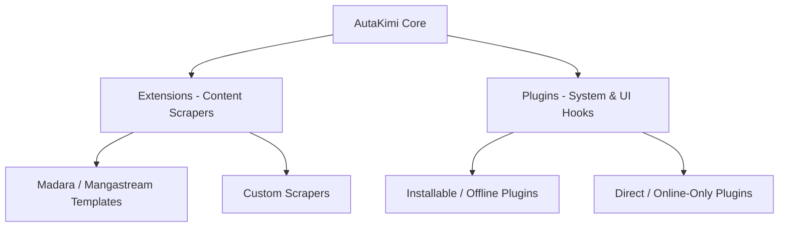

# AutaKimi Developer Extensibility Guide

AutaKimi features an advanced, decentralized, sandboxed, and highly modular architecture for extending the desktop application. This guide covers how developers can build **Extensions** (content scrapers) and **Plugins** (system hooks and behaviors).

---

## 🗺️ Architectural Overview

There are two primary ways to extend AutaKimi:



### 1. Extensions (Scrapers)
Extensions are pure-JavaScript content scrapers. They run in a worker thread sandbox to fetch, parse, and structure media catalogs (Manga and Anime) from third-party sites using custom engines or standard themes.

### 2. Plugins (System/UI Hooks)
Plugins let developers inject raw hooks, event listeners, or custom behaviors directly into the application's runtime processes. 

---

## 🧩 Extensions (Scrapers) Development

AutaKimi extensions reside inside your configured repository under the `js/` folder, and are indexed inside `templates.json`.

### 1. Structure of `templates.json`
Your remote repository repository must expose a `templates.json` index:

```json
[
  {
    "pkg": "ma.autakimi.extension.example",
    "name": "Example Manga",
    "version": "1.0.0",
    "lang": "en",
    "sources": [
      {
        "baseUrl": "https://example.com"
      }
    ]
  }
]
```

### 2. Scraper Code Structure
Every scraper must implement the standard SDK scraper interface:

```javascript
module.exports = {
  getLatestManga: async (page) => {
    // Return standard array of Manga items
  },
  getMangaDetails: async (url) => {
    // Return detailed Manga object
  },
  getMangaChapters: async (url) => {
    // Return list of chapters
  },
  getPageImages: async (chapterUrl) => {
    // Return list of page image URLs
  }
}
```

---

## 🔌 Plugins Development

Plugins allow running sandboxed code within specific system zones. They are indexable in `plugins.json` in the root of your remote repository.

### 1. Plugin Manifest Structure (`plugins.json`)

```json
{
  "plugins": [
    {
      "id": "auto-solve-cloudflare",
      "name": "Auto Solve Cloudflare",
      "description": "Automatically attempts to solve Cloudflare Turnstile challenges in background windows.",
      "author": "AutaKimi Community",
      "version": "1.0.0",
      "target": "main-cloudflare",
      "installable": false,
      "code": "..."
    }
  ]
}
```

### 2. Plugin Targets
The `target` property dictates exactly where in the system loop the plugin executes:

*   **`main-cloudflare`**: Runs in the Electron Main process during Cloudflare Turnstile challenges. Ideal for automation and stealth bypassing.
*   **`renderer-reader`**: Runs in the React Renderer context. Perfect for custom styling, reading modes, and keyboard bindings.

### 3. Optional Offline Persistence (`installable`)

AutaKimi provides developers with two modes of execution for plugins:

#### A. **Direct / Online-Only Plugins (`installable: false`)**
Ideal for helper tools, network bypasses (e.g., Cloudflare solvers), or dynamic tools that rely on live connections:
*   **Bypasses Installation**: There is no "Install" button. Users simply toggle them **On/Off**.
*   **Volatile Code, Persistent Settings**: The toggle switch state is saved in the SQLite DB, but the code itself is loaded directly from memory.

#### B. **Installable / Offline-Capable Plugins (`installable: true` or undefined)**
Ideal for custom themes, local trackers, or UI layout shifts that users need to run without internet:
*   **One-Click Local Cache**: Users must click **Install** to cache the plugin.
*   **Permanent Local Cache**: Saved directly inside SQLite (`installed_plugins`). It will run immediately at startup even if the user is completely offline.

> [!TIP]
> **🚀 Recommendation: Keep Media Scrapers and Network Solvers Online-Only (`installable: false`)!**
> 
> While keeping plugins installable allows complete offline usage (optional and supported), we **strongly recommend keeping all Manga/Anime scrapers, Cloudflare bypassers, and parser plugins online-only (non-installable)**:
> 
> *   **Zero-Intervention Hot Updates**: When a target manga/anime site changes its DOM structure or cloudflare settings, you can push a hotfix commit to your GitHub repository.
> *   **Immediate Delivery**: The client instantly downloads and evaluates the newest version in-memory on their very next live session. The user doesn't have to manually go to Settings and click "Update" to fix a broken scraper!
> *   **Use Caching Only for Pure Local Utilities**: Reserve `installable: true` solely for visual styles, custom readers, or trackers that require strict offline access.

### 4. Proactive Update & Refresh Toast Notifications
AutaKimi features an automated, smart update and refresh monitoring system that triggers context-sensitive toasts in the UI to keep sources and plugins up-to-date:

1.  **For Installable Items (Manual Update Needed)**:
    - **Trigger**: When an installed plugin or extension has a newer registered version available in the catalog.
    - **Notification**: User gets a Toast stating: *"Available plugins/sources need to be updated. Please click the Update button."*
    - **Action**: User clicks the prominent pulsing **Update** button on the target plugin list card in Settings.
2.  **For Non-Installable/Online-Only Items (Refresh Needed)**:
    - **Trigger**: When online Manga/Anime scrapers or online-only plugins have hot-updates detected in the repository catalogs.
    - **Notification**: User gets a Toast stating: *"Manga/Anime sources and online plugins need a refresh. Please go and click the 'Refresh Repositories' button."*
    - **Action**: User goes to the Settings header and clicks the prominent **"Refresh Repositories"** button to instantly reload and hydrate the live memory catalogs with the latest remote version.

---

## 🛡️ Sandbox & Context Environment

Plugins run in a locked-down virtual machine context (`vm.Script`) with a filtered proxy of the system internals.

### Available Context APIs

Inside your plugin code, you have access to:

*   **`console`**: Integrated console redirection (`console.log`, `console.error`) with prefixing.
*   **Timers**: Standard `setTimeout`, `setInterval`, `clearTimeout`, `clearInterval`.
*   **Standard Classes**: `Promise`, `Buffer`, `URL`, `Math`, `Date`, `JSON`.
*   **`context`**: A context proxy passed by the host system:
    *   In `main-cloudflare`, the `context` includes `win`, which acts as a safe, isolated proxy of the target challenge window:
        ```javascript
        // Example: Solve challenge automatically
        const title = context.win.getTitle();
        if (title.includes("Cloudflare")) {
          console.log("Stealth window detected Cloudflare challenge!");
        }
        ```

### Disposers & Cleanup
If your plugin runs asynchronous loops or attaches event listeners, your entry function should return a **Disposer function** for clean de-allocation when disabled or uninstalled:

```javascript
// Plugin Entry
(async (context, console) => {
  const intervalId = setInterval(() => {
    console.log("Plugin tick...");
  }, 5000);

  // Return clean up routine
  return () => {
    clearInterval(intervalId);
    console.log("Plugin clean up completed!");
  };
});
```

---

> [!WARNING]
> Accessing Node.js modules like `fs`, `path`, `child_process`, or Electron's direct `ipcMain`/`ipcRenderer` inside the sandbox is strictly blocked to maintain security. Always use the provided proxies inside `context`.
